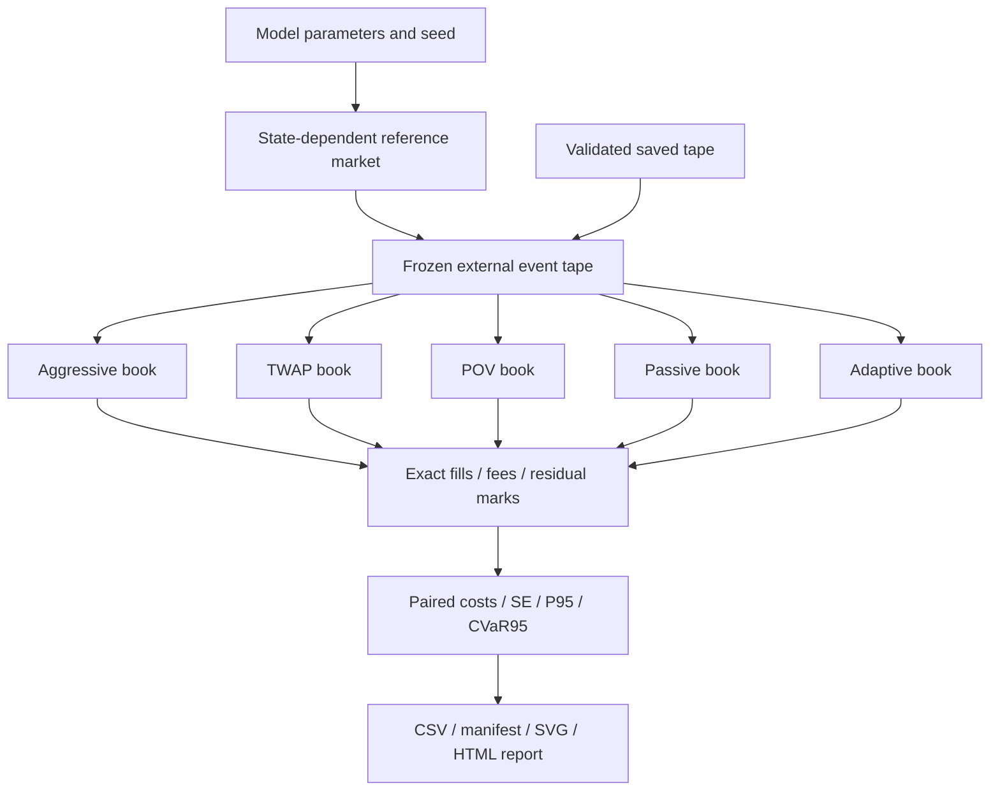
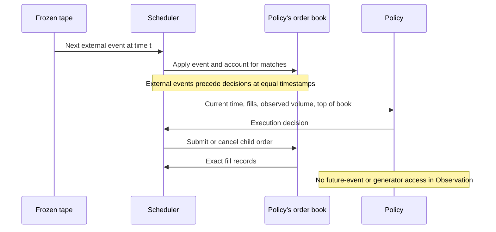
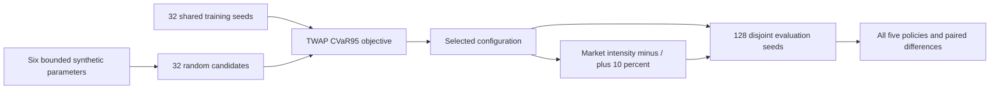

# Mercury

[](https://github.com/Ekanshthegreat/Mercury/actions/workflows/ci.yml)

**A C++20 market-microstructure laboratory for execution, reproducible simulation
and synthetic tail-risk experiments.**

[Explore the interactive report](https://ekanshthegreat.github.io/Mercury/) ·
[Architecture](docs/ARCHITECTURE.md) · [Experiment design](docs/EXPERIMENTS.md) ·
[Tape format](docs/TAPES.md) · [Release history](CHANGELOG.md)

Mercury asks a concrete question: **how does the same trading objective behave
under different order-flow conditions and execution policies?** It combines a
price-time-priority order book, a seeded market generator and five causal
execution policies. Each comparison reuses one external event tape across
independent books, then exports every fill, fee and residual quantity.


| Core | Experiments | Evidence |
| --- | --- | --- |
| Integer prices, FIFO queues, exact match records | Five policies on shared external streams | Hand-computed accounting and causal-prefix tests |
| Virtual nanosecond clock and seeded flow | Bounded stress search with disjoint holdout seeds | 128-seed committed reference experiment |
| Independent book per policy | CPU workers with stable result ordering | Exact serial/parallel equivalence tests |
| Versioned saved tapes with bounded loading | Replay without market regeneration | Exact round-trip fills and corruption rejection |

The Pages site serves the committed interactive report and downloadable results.
The C++ engine runs locally. These experiments use a synthetic, uncalibrated
market; the selected regime is a model failure case, not evidence about a venue.

## Architecture at a glance



External events are shared; queue state is not. Each policy changes its own
replayed book. The generator's future arrival rates remain frozen, so the
counterfactual deliberately omits feedback from the trader into market flow.

## Causality by construction



Prefix tests alter future events and require earlier policy decisions to remain
identical. At the common deadline, resting execution children are cancelled and
each policy attempts closeout. Unfilled shares remain residual inventory with an
explicit mark and penalty; they are never reported as fictitious fills.

## Stress search and holdout design



These counts describe the committed reference run. Search uses common training
seeds across candidates; the selected configuration is evaluated on a separate
seed range. Neighbor checks test sensitivity to market intensity. Random search
is bounded and inspectable; it is not claimed to be an optimal optimizer.

## Engineering decisions

| Decision | Consequence | Inspect |
| --- | --- | --- |
| Sorted price levels, FIFO orders, ID index | Price-time matching and cancellation without scanning the entire book | [Matching engine](engine/book/order_book.cpp) |
| Exact match records | Multi-level costs use each executed price | [Execution tests](tests/test_execution.cpp) |
| Policy sees only current Observation | Future events are unavailable through the decision interface | [Execution interface](engine/execution/execution.hpp) |
| One worker owns its market and books | No shared mutable book state; aggregation preserves ordering | [Experiments](engine/experiments/experiment.cpp) |
| Bounded file and event budgets | Invalid or oversized replay input fails before result export | [Tape loader](engine/experiments/tape_io.cpp) |
| Sanitizers plus reference-model testing | Memory checks complement matching/conservation checks | [Property tests](tests/test_order_book_property.cpp), [CI](.github/workflows/ci.yml) |

## Quick start

Requirements: C++20 with GCC or Clang, CMake 3.21+, a build tool, and Python 3.10+
for report generation. Linux and macOS are supported; MSVC is not currently
supported because the RNG uses a 128-bit integer extension.

```sh
cmake -S . -B build -DCMAKE_BUILD_TYPE=Release -DMERCURY_WERROR=ON
cmake --build build --parallel 4
ctest --test-dir build --output-on-failure
./build/mercury_experiment stress --out results/demo
python3 scripts/report.py results/demo
```

Open `results/demo/report.html` in a browser. It is a standalone report with a
regime selector, cost charts, paired comparisons and links to raw results.
The default stress run is small: 16 candidates, 16 training seeds and 32 evaluation
seeds per regime. Use the [committed reference experiment](examples/reference/)
for a larger example, or reproduce it with:

```sh
./scripts/reproduce.sh
```

That builds and tests a fresh build directory, checks the CLI, runs the reference
experiment and generates `results/reproduction/report.html`. It also replays
the committed baseline tape into `results/reference-replay/report.html`.

## What the MVP implements

| Component | Behavior |
| --- | --- |
| Order book | Price-time matching, partial fills, cancel/reduce, GTC/IOC/FOK, exact per-match records |
| Market model | Seeded, state-dependent limit, market and cancellation events on a virtual clock |
| Policies | Aggressive, TWAP, participation-of-volume, passive and adaptive catch-up |
| Experiments | One shared external tape per seed/regime; deterministic serial/parallel results |
| Stress search | Bounded random search of six synthetic parameters, optimizing TWAP CVaR95 |
| Validation | Separate evaluation seeds and ±10% market-intensity neighbors |
| Output | Configuration manifest, run/summary CSV, individual fills, market tapes, decision traces, SVG charts and HTML report |

Example commands:

```sh
./build/mercury_cli demo
./build/mercury_cli simulate --seed 7 --seconds 60
./build/mercury_experiment compare --runs 128 --side sell --workers 4 --out results/sell
./build/mercury_experiment stress --runs 128 --candidates 32 --training-runs 32 --workers 4 --out results/stress
./build/mercury_experiment compare --runs 128 --maker-fee -0.05 --taker-fee 0.15 --out results/fees
./build/benchmarks/bench_submit_latency
```

Use `mercury_experiment --help` for all options. `compare` evaluates only the
baseline; `stress` adds the selected regime and two neighboring regimes.

## Replay a saved market stream

```sh
./build/mercury_experiment replay --tape examples/reference/tapes/baseline.mtape --out results/replay
python3 scripts/report.py results/replay
```

The file includes the initial book configuration and every external event.
Replay runs all five policies without invoking the market generator. Choose
`--quantity`, `--side`, `--maker-fee` and `--taker-fee` explicitly to match a
custom original execution. Defaults are a 2,000-share buy with zero fees.
`compare` and `stress` save the first evaluation seed of each regime under
`tapes/`; they do not archive every evaluation seed. One replay is a diagnostic,
not a tail-risk estimate. See [tape format and replay](docs/TAPES.md).

## Reference result

The committed example executes a 2,000-share buy over 60 virtual seconds. Search
uses seed 7 and 32 training seeds per candidate. Evaluation uses seeds
1,000,007–1,000,134, which were not used for selection.

| TWAP regime | Mean cost, ticks/share | Standard error | CVaR95 | Fill rate |
| --- | ---: | ---: | ---: | ---: |
| Baseline | 1.220 | 0.103 | 4.143 | 96.41% |
| Selected | 5.724 | 0.301 | 15.022 | 100.00% |
| Lower market intensity | 5.105 | 0.328 | 13.327 | 100.00% |
| Higher market intensity | 5.497 | 0.288 | 14.404 | 99.99% |

This demonstrates a failure case inside the synthetic model. It does not
establish a calibrated real-market failure. The adaptive policy also performs
poorly in this selected regime; passive and POV behave differently. See
[experiment interpretation](docs/EXPERIMENTS.md) for the mechanism, accounting
choices and limitations. Every table value comes from the committed
[summary CSV](examples/reference/summary.csv), with the full configuration and
build environment alongside it.

## Uncertainty in the comparisons

The report now displays 95% percentile-bootstrap intervals for CVaR95 and paired
mean cost differences against TWAP. Each interval uses 512 deterministic
resamples of the observed run costs. Paired comparisons keep the same seed's
policy and TWAP costs together. The CSV exports record seeds, sample sizes and
resample counts; single-tape replay does not estimate intervals.

These are diagnostics conditional on the observed synthetic sample. At 128
seeds, the empirical worst 5% spans only 6.4 observations. Bootstrap resampling
cannot recover rare outcomes absent from those runs or account for model error
and regime-selection bias. See [experiment notes](docs/EXPERIMENTS.md).

## Engineering checks

There are 64 C++ test cases across six suites, four Python end-to-end checks and seven
report-integrity checks.
They cover book invariants, randomized reference-model comparisons, deterministic
simulation, exact fill accounting, passive queue priority, causal policy prefixes,
residual quantity, serial/parallel equivalence, tape round trips, corruption
rejection and input validation.

```sh
python3 scripts/check_cli.py build
cmake --preset sanitize
cmake --build --preset sanitize --parallel 4
ctest --preset sanitize
```

CI runs strict Release and ASan/UBSan Debug builds on Linux and macOS, then
publishes regenerated experiment reports as downloadable workflow artifacts.
Reproduction is deterministic within a build/platform. Floating-point `log` and
`exp` implementations can differ across platforms; cross-platform bit identity
is not promised.

## Read the code

[Architecture](docs/ARCHITECTURE.md) gives a reading order and explains the
interfaces. [Experiments](docs/EXPERIMENTS.md) defines metrics, policies, search
bounds and output files. [Roadmap](docs/implementation_plan.md) distinguishes the
completed CPU MVP from later calibration, integration and acceleration work.

```
engine/book/         matching and queue invariants
engine/simulation/   market generation and virtual time
engine/execution/    observable-state decisions and tape replay
engine/experiments/  tail statistics, parallel comparisons and regime search
apps/                command-line tools
scripts/             reproduction, report rendering and end-to-end checks
examples/reference/  measured synthetic results and charts
```

Every fill is exported with its time, quantity, price and maker/taker classification.
The CLI checks reconstruct requested/filled/residual quantities and cost directly
from exported fills. `--maker-fee` and `--taker-fee` are explicit ticks per filled
share; negative maker fees model rebates. Defaults are zero and are not a claim
about any exchange's fee schedule.

<details>
<summary><strong>Model assumptions and limitations</strong></summary>

## Model boundaries

The comparison freezes external event times, prices, sizes and cancellation IDs
before execution. Policy orders change queues and fills during replay; they do
not change external arrival rates. This separates shared inputs from policy
outcomes, but it omits feedback from the trader into subsequent market behavior.

The model is not empirically calibrated. Search bounds are explicit synthetic
assumptions. Policies have a common deadline market-closeout attempt; remaining
shares are marked at the final valid mid with a 10-tick/share penalty and remain
reported as unfilled. When a final two-sided mid is unavailable, the arrival mid
is the documented fallback. Latency, hidden liquidity, adverse-selection
markouts and real trading connectivity are outside this release. Prices are in
ticks around a zero arrival mid, so costs are reported in ticks rather than bps.

The optional excitation is a frozen-rate approximation, not an exact Hawkes
thinning sampler. CUDA, Python bindings, empirical calibration and a live web API
are roadmap items. No performance claims are made for unimplemented backends.

</details>

MIT licensed. Literature background is listed in [references](docs/references.md).

## Publishing the report

The Pages workflow copies `examples/reference/` as a self-contained site and
serves `report.html` as its index. CSV, charts, configuration and replay tapes
remain available beside it. Deployment follows successful main-branch Linux
and macOS checks; pull requests do not publish. The hosted report describes the
committed reference, not a live run or trading service.
