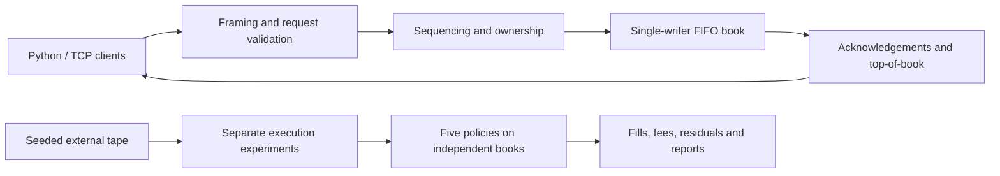
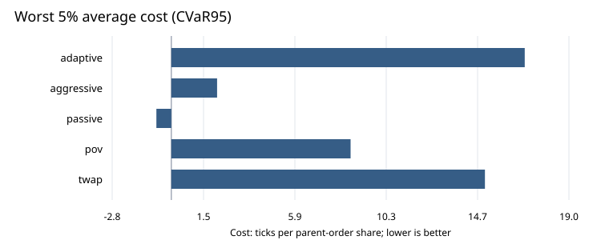

# Mercury

[](https://github.com/Ekanshthegreat/Mercury/actions/workflows/ci.yml)

A C++20 order book, TCP order gateway and execution simulator.

[Experiment report](https://ekanshthegreat.github.io/Mercury/) ·
[Gateway protocol](docs/GATEWAY.md) · [Performance](docs/PERFORMANCE.md) ·
[Architecture](docs/ARCHITECTURE.md) · [Experiments](docs/EXPERIMENTS.md)

## Build

Linux or macOS, C++20, CMake 3.21+ and Python 3.10+; no external C++ dependencies.

```sh
cmake -S . -B build -DCMAKE_BUILD_TYPE=Release -DMERCURY_WERROR=ON
cmake --build build --parallel 4
ctest --test-dir build --output-on-failure
```

## Trade through the gateway

```sh
# Terminal 1
./build/mercury_gateway --port 9090

# Terminal 2
python3 scripts/gateway_client.py --port 9090 "LIMIT BUY 99 10 GTC" "TOP" "CANCEL 1"
```

Orders from connected clients share one price-time-priority book. The server
assigns order IDs and serializes mutations on one event loop. Requests and
responses use bounded, length-prefixed TCP frames.



The gateway and offline experiments are separate entry points into the same
matching engine. The gateway is an in-memory loopback service: no venue
connectivity, authentication, replication or durable order recovery. Disconnect
cancels that connection's remaining orders. [Protocol and failure behavior](docs/GATEWAY.md).

## Measure it

```sh
python3 scripts/check_gateway.py build
python3 scripts/bench_gateway.py --build build --clients 4 --pairs 1000 --out results/gateway
```

The benchmark saves raw samples, percentile summaries and machine/build metadata.
It measures closed-loop client/server round trips. [Performance guide](docs/PERFORMANCE.md)
includes Linux profiling commands and explains what the numbers cover.

## Run an execution experiment

```sh
./build/mercury_experiment stress --out results/demo
python3 scripts/report.py results/demo
python3 scripts/verify_latency.py examples/latency
```

Open `results/demo/report.html`. Five policies replay the same external event
tape on independent books; every fill, fee and residual is exported. Search uses
training seeds separate from evaluation. Costs, paired differences and empirical
tail statistics can be checked against the raw runs.



The market generator is synthetic and uncalibrated. Frozen external flow does
not respond to the execution policy. Results describe this model and sample.
See [experiment design](docs/EXPERIMENTS.md), [submission delay](docs/LATENCY.md)
and [saved tapes](docs/TAPES.md).

## Check changes

```sh
python3 scripts/check_cli.py build
./scripts/reproduce.sh
```

CI runs Linux/macOS Release and ASan/UBSan builds, the book and execution tests,
TCP integration checks, a small benchmark and archive verification. Saved
reference results and benchmark artifacts make the checks inspectable.

[MIT license](LICENSE) · [Changes](CHANGELOG.md)
