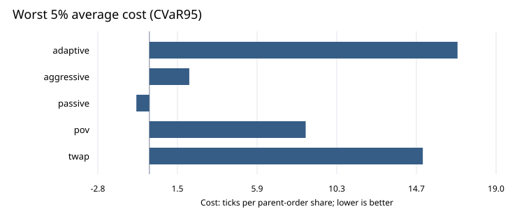

# Mercury

[](https://github.com/Ekanshthegreat/Mercury/actions/workflows/ci.yml)

A C++20 market-microstructure lab for comparing execution policies and searching
for synthetic regimes where execution becomes expensive. The CPU MVP runs locally
with no accounts, market-data subscription or external C++ dependencies.

Mercury combines a price-time-priority limit order book, state-dependent order
flow, five execution policies, parallel experiments and inspectable reports.



## Quick start

Requirements: C++20 with GCC or Clang, CMake 3.21+, a build tool, and Python 3.10+
for report generation. Linux and macOS are supported; MSVC is not currently
supported because the RNG uses a 128-bit integer extension.

```sh
cmake -S . -B build -DCMAKE_BUILD_TYPE=Release -DMERCURY_WERROR=ON
cmake --build build --parallel 4
ctest --test-dir build --output-on-failure
./build/mercury_experiment stress --out results/demo
python3 scripts/report.py results/demo
```

Open `results/demo/report.html` in a browser. It is a standalone report with a
regime selector, cost charts, paired comparisons and links to raw results.
The default stress run is small: 16 candidates, 16 training seeds and 32 evaluation
seeds per regime. Use the [committed reference experiment](examples/reference/)
for a larger example, or reproduce it with:

```sh
./scripts/reproduce.sh
```

That builds and tests a fresh build directory, checks the CLI, runs the reference
experiment and generates `results/reproduction/report.html`.

## What the MVP implements

| Component | Behavior |
| --- | --- |
| Order book | Price-time matching, partial fills, cancel/reduce, GTC/IOC/FOK, exact per-match records |
| Market model | Seeded, state-dependent limit, market and cancellation events on a virtual clock |
| Policies | Aggressive, TWAP, participation-of-volume, passive and adaptive catch-up |
| Experiments | One shared external tape per seed/regime; deterministic serial/parallel results |
| Stress search | Bounded random search of six synthetic parameters, optimizing TWAP CVaR95 |
| Validation | Separate evaluation seeds and ±10% market-intensity neighbors |
| Output | Configuration manifest, raw run CSV, summary CSV, decision traces, SVG charts and HTML report |

Example commands:

```sh
./build/mercury_cli demo
./build/mercury_cli simulate --seed 7 --seconds 60
./build/mercury_experiment compare --runs 128 --side sell --workers 4 --out results/sell
./build/mercury_experiment stress --runs 128 --candidates 32 --training-runs 32 --workers 4 --out results/stress
./build/benchmarks/bench_submit_latency
```

Use `mercury_experiment --help` for all options. `compare` evaluates only the
baseline; `stress` adds the selected regime and two neighboring regimes.

## Reference result

The committed example executes a 2,000-share buy over 60 virtual seconds. Search
uses seed 7 and 32 training seeds per candidate. Evaluation uses seeds
1,000,007–1,000,134, which were not used for selection.

| TWAP regime | Mean cost, ticks/share | Standard error | CVaR95 | Fill rate |
| --- | ---: | ---: | ---: | ---: |
| Baseline | 1.220 | 0.103 | 4.143 | 96.41% |
| Selected | 5.724 | 0.301 | 15.022 | 100.00% |
| Lower market intensity | 5.105 | 0.328 | 13.327 | 100.00% |
| Higher market intensity | 5.497 | 0.288 | 14.404 | 99.99% |

This demonstrates a failure case inside the synthetic model. It does not
establish a calibrated real-market failure. The adaptive policy also performs
poorly in this selected regime; passive and POV behave differently. See
[experiment interpretation](docs/EXPERIMENTS.md) for the mechanism, accounting
choices and limitations. Every table value comes from the committed
[summary CSV](examples/reference/summary.csv), with the full configuration and
build environment alongside it.

## Engineering checks

There are 52 C++ test cases across five suites and two Python end-to-end checks.
They cover book invariants, randomized reference-model comparisons, deterministic
simulation, exact fill accounting, passive queue priority, causal policy prefixes,
residual quantity, serial/parallel equivalence and input validation.

```sh
python3 scripts/check_cli.py build
cmake --preset sanitize
cmake --build --preset sanitize --parallel 4
ctest --preset sanitize
```

CI runs strict Release and ASan/UBSan Debug builds on Linux and macOS, then
publishes regenerated experiment reports as downloadable workflow artifacts.
Reproduction is deterministic within a build/platform. Floating-point `log` and
`exp` implementations can differ across platforms; cross-platform bit identity
is not promised.

## Read the code

[Architecture](docs/ARCHITECTURE.md) gives a reading order and explains the
interfaces. [Experiments](docs/EXPERIMENTS.md) defines metrics, policies, search
bounds and output files. [Roadmap](docs/implementation_plan.md) distinguishes the
completed CPU MVP from later calibration, integration and acceleration work.

```
engine/book/         matching and queue invariants
engine/simulation/   market generation and virtual time
engine/execution/    observable-state decisions and tape replay
engine/experiments/  tail statistics, parallel comparisons and regime search
apps/                command-line tools
scripts/             reproduction, report rendering and end-to-end checks
examples/reference/  measured synthetic results and charts
```

## Model boundaries

The comparison freezes external event times, prices, sizes and cancellation IDs
before execution. Policy orders change queues and fills during replay; they do
not change external arrival rates. This separates shared inputs from policy
outcomes, but it omits feedback from the trader into subsequent market behavior.

The model is not empirically calibrated. Search bounds are explicit synthetic
assumptions. Policies have a common deadline market-closeout attempt; remaining
shares are marked at the final valid mid with a 10-tick/share penalty and remain
reported as unfilled. When a final two-sided mid is unavailable, the arrival mid
is the documented fallback. Fees, latency, hidden liquidity, adverse-selection
markouts and real trading connectivity are outside this release. Prices are in
ticks around a zero arrival mid, so costs are reported in ticks rather than bps.

The optional excitation is a frozen-rate approximation, not an exact Hawkes
thinning sampler. CUDA, Python bindings, empirical calibration and a live web API
are roadmap items. No performance claims are made for unimplemented backends.

MIT licensed. Literature background is listed in [references](docs/references.md).
