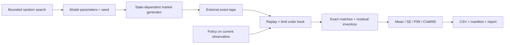

# Architecture and reading guide

## Matching

`engine/book/order_book.*` stores sorted price levels in `std::map` and FIFO
orders within each level. An ID index locates resting orders for cancellation
without scanning all orders. Submit results include individual matches, so
multi-level cost accounting uses each executed price rather than the final
trade price multiplied by the entire quantity. Prices and quantities are
integers; time is virtual nanoseconds. Price validation reserves arithmetic
headroom. The engine is single-threaded per book.

## Generation versus execution

`MarketSimulator` creates a policy-independent tape. Rates respond to its
reference book's queue state and spread. An exponential wait and weighted event
choice select each next event. Events beyond the horizon are not applied.
Configuration rejects non-finite inputs, and an event budget bounds extreme runs.

`replay_execution` constructs an identical initial book, applies tape events in
time order and merges them with scheduled policy decisions. External events at
the same timestamp are applied first. Each policy sees only `Observation`: the
current time, filled quantity, already observed external volume and top of book.
There is no future-event or random-generator field in the decision interface.
Prefix tests modify future tape events and require all policies' earlier
decisions to remain identical.

Execution orders use a separate ID range. Incoming external trades can fill a
passive execution order; exact match records identify those fills. Passive
orders are cancelled before repricing so old and new children cannot overfill
the parent. All policies cancel any resting child and attempt a market closeout
at the deadline. Remaining shares are residual inventory, not fictitious fills.

Absolute external limit prices may cross after policy-induced queue changes,
even if the original generator placed them passively. Recorded cancellation IDs
can become no-ops after execution has already consumed those orders. Those are
explicit consequences of the frozen-tape counterfactual design.

## Experiments and concurrency

One tape is generated per seed and reused across five isolated replay books.
CPU workers each own their market and books; they write to disjoint result
indices. Joining workers before aggregation preserves seed/policy ordering.
Worker exceptions propagate to the caller. Parallel-equivalence tests compare
results exactly against the serial run within the same build.

Search evaluates each candidate using the same training seed set, maximizing
TWAP CVaR95. It then evaluates the selected configuration on disjoint holdout
seeds, compares every policy and perturbs market intensity. The search is random
search, not CMA-ES or Bayesian optimization. It is not claimed to outperform
other optimizers.

`statistics.hpp` computes sample standard error, nearest-rank P95 and an exact
5% empirical tail average with fractional boundary weighting. Comparing a policy
against TWAP uses per-seed cost differences and their standard error. CLI and
CSV serialization sit outside these core functions.

## Suggested reading order

| File | Engineering idea |
| --- | --- |
| `engine/core/types.hpp` | Integer price/quantity contracts and virtual time |
| `engine/book/order_book.cpp` | Matching, FIFO priority and ID lifetime |
| `tests/test_order_book_property.cpp` | Reference-model and conservation checks |
| `engine/simulation/market_simulator.cpp` | Random sampling, model state and bounded time |
| `engine/execution/execution.cpp` | Causal observations, scheduler and execution accounting |
| `tests/test_execution.cpp` | Hand-computed costs, queue priority and look-ahead tests |
| `engine/experiments/experiment.cpp` | Shared inputs, independent workers and search |
| `engine/experiments/statistics.hpp` | Tail metrics and sampling uncertainty |
| `apps/experiments/main.cpp` | Budget validation and reproducible exports |
| `scripts/report.py` | Presenting computed evidence without a second model |

The project supports discussion of C++ memory/data structures, algorithms,
Monte Carlo experiments, concurrency, testing and market microstructure. The
current implementation does not support claims of live execution, calibrated
market realism, an optimal scheduler or GPU acceleration.
